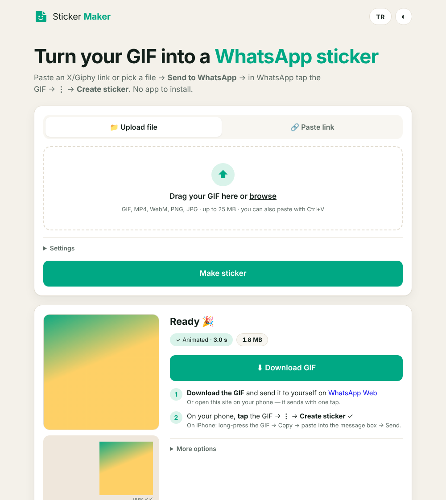
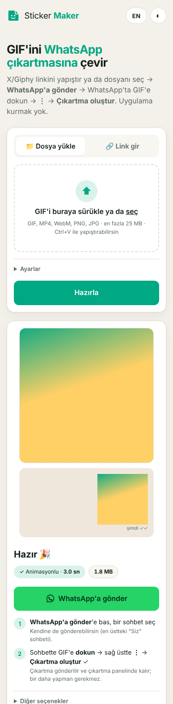

<div align="center">


# Sticker Maker

**Turn any GIF into a WhatsApp sticker — free, no app, right in your browser.**<br />
**Herhangi bir GIF'i WhatsApp çıkartmasına çevir — ücretsiz, uygulamasız, tarayıcında.**

[](https://nolarth.github.io/sticker-maker/)

[](https://github.com/nolarth/sticker-maker/actions/workflows/pages.yml)
[](LICENSE)

-555)

[English](#english) · [Türkçe](#türkçe)

&nbsp;


</div>

---

## English

**Sticker Maker** converts GIFs from **X (Twitter)**, **Giphy**, direct links or your own files into WhatsApp stickers. Everything runs in your browser with [ffmpeg.wasm](https://github.com/ffmpegwasm/ffmpeg.wasm) — nothing is uploaded, nothing to install.

👉 **Try it: <https://nolarth.github.io/sticker-maker/>**

### How it works

1. Paste an X / Giphy link or pick a GIF → **Make sticker**
2. **Send to WhatsApp** (opens the share sheet on phones; downloads the GIF on desktop)
3. In WhatsApp:
   - **Android:** tap the GIF → **⋮** → **Create sticker**
   - **iPhone:** long-press the GIF → **Copy** → paste into the message box → **Send**

The sticker stays in your sticker panel afterwards.

> **Why not send it as a sticker directly?** Websites can't add stickers to WhatsApp: the browser share sheet only passes standard file types (`image/webp`, `image/gif`, …), which WhatsApp treats as images/GIFs. Sticker sending (`image/webp.wasticker`, `SEND_STICKER`) is only available to installed apps. Sending a GIF and using WhatsApp's own *Create sticker* is the shortest path.

### Features

- **Links:** X (Twitter) posts (`x.com/…/status/…`, incl. `/photo/1`, `/video/2`; the link is extracted even from pasted share text), Giphy, direct `.gif` links
- **Files:** drag & drop, file picker or Ctrl+V — GIF, MP4, WebM, PNG, JPG (up to 25 MB)
- **Options:** fit / square crop / stretch, start time; stickers are trimmed to 10 s; GIF auto-shrinks to ≤ 8 MB
- **WebP export:** 512×512, transparent, ≤ 500 KB animated WebP for sticker apps
- **Bilingual:** English & Turkish — follows your system language, switch with the **EN/TR** button (remembered); `?lang=en` / `?lang=tr` links
- **Private:** conversion happens on your device; the converter (~30 MB) is downloaded once and cached
- Light/dark theme, mobile-first, SEO-ready (Open Graph, JSON-LD, sitemap, hreflang)

### Limitations

- X links rely on the public [FxTwitter](https://github.com/FxEmbed/FxEmbed) API (fallback: VxTwitter). Private/age-restricted posts aren't supported.
- Link downloads only work from sites that allow cross-origin requests (Giphy, X media, Tenor *media* links…). Otherwise download the GIF and upload it.
- Animated WebP input isn't supported (ffmpeg can't decode it).
- GIFs can't keep full transparency, so stickers made via WhatsApp's *Create sticker* have a solid background.

### Development

Requires Node.js 18+. No build step — `public/` is the site.

```bash
npm start              # http://localhost:8080
npm test               # unit tests (links, i18n, SEO)
npm install            # dev dependency: @ffmpeg/core (for e2e tests)
npm run test:e2e       # real conversions in Chromium (needs playwright + ffmpeg)
npm run images         # regenerate og-image.png and icons
```

### Deploy (GitHub Pages)

1. **Settings → Pages → Source:** *GitHub Actions*
2. Push to the default branch. [`.github/workflows/pages.yml`](.github/workflows/pages.yml) runs the tests, adds cache-busting version tags, pre-renders English text into `index.html` for crawlers, and publishes `public/`.

### Project structure

| Path | Purpose |
|---|---|
| `public/index.html`, `style.css` | Page, SEO tags, FAQ |
| `public/js/app.js` | UI, send to WhatsApp (Web Share), per-device steps |
| `public/js/converter.js` | ffmpeg.wasm: GIF & WebP output, size fitting |
| `public/js/links.js` | Link downloads, X & Giphy resolving |
| `public/js/i18n.js` | English/Turkish strings, language detection |
| `public/vendor/ffmpeg/` | `@ffmpeg/ffmpeg` ESM files (worker must be same-origin) |
| `public/robots.txt`, `sitemap.xml`, `manifest.webmanifest` | SEO & install metadata |
| `scripts/` | Dev server, pre-render, image generator |
| `test/` | Unit tests and end-to-end test |

---

## Türkçe

**Sticker Maker**; **X (Twitter)**, **Giphy**, doğrudan linkler veya kendi dosyalarındaki GIF'leri WhatsApp çıkartmasına çevirir. Her şey tarayıcında [ffmpeg.wasm](https://github.com/ffmpegwasm/ffmpeg.wasm) ile çalışır — hiçbir şey yüklenmez, hiçbir şey kurulmaz.

👉 **Dene: <https://nolarth.github.io/sticker-maker/?lang=tr>**

### Nasıl çalışır?

1. X / Giphy linkini yapıştır ya da GIF seç → **Hazırla**
2. **WhatsApp'a gönder** (telefonda paylaşım ekranı açılır; bilgisayarda GIF indirilir)
3. WhatsApp'ta:
   - **Android:** GIF'e dokun → **⋮** → **Çıkartma oluştur**
   - **iPhone:** GIF'e basılı tut → **Kopyala** → mesaj kutusuna yapıştır → **Gönder**

Çıkartma bundan sonra çıkartma panelinde kalır.

> **Neden doğrudan çıkartma olarak gönderilmiyor?** Web siteleri WhatsApp'a çıkartma ekleyemez: tarayıcının paylaş özelliği yalnızca standart dosya türlerini (`image/webp`, `image/gif` …) iletir ve WhatsApp bunları resim/GIF olarak alır. Çıkartma gönderme (`image/webp.wasticker`, `SEND_STICKER`) yalnızca telefona kurulu uygulamalara açıktır. GIF gönderip WhatsApp'ın kendi *Çıkartma oluştur* özelliğini kullanmak en kısa yol.

### Özellikler

- **Linkler:** X (Twitter) gönderileri (`x.com/…/status/…`, `/photo/1`, `/video/2` dahil; paylaşım metni yapıştırılsa da link ayıklanır), Giphy, doğrudan `.gif` linkleri
- **Dosyalar:** sürükle-bırak, dosya seçici veya Ctrl+V — GIF, MP4, WebM, PNG, JPG (en fazla 25 MB)
- **Ayarlar:** sığdır / kare kırp / uzat, başlangıç saniyesi; çıkartmalar 10 sn'ye kırpılır; GIF en fazla 8 MB olacak şekilde küçültülür
- **WebP çıktısı:** çıkartma uygulamaları için 512×512, şeffaf, ≤ 500 KB animasyonlu WebP
- **İki dil:** İngilizce ve Türkçe — sistem diline göre açılır, **EN/TR** butonuyla değiştirilir (hatırlanır); `?lang=en` / `?lang=tr` linkleri
- **Gizlilik:** dönüştürme cihazında yapılır; dönüştürücü (~30 MB) bir kez indirilir ve önbellekte kalır
- Açık/koyu tema, mobil öncelikli, SEO hazır (Open Graph, JSON-LD, sitemap, hreflang)

### Bilinen sınırlar

- X linkleri herkese açık [FxTwitter](https://github.com/FxEmbed/FxEmbed) API'sine (yedek: VxTwitter) dayanır. Gizli/yaş kısıtlamalı gönderiler desteklenmez.
- Linkten indirme yalnızca başka sitelerden erişime izin veren kaynaklarda çalışır (Giphy, X medyası, Tenor *medya* linkleri…). Aksi halde GIF'i indirip yükle.
- Animasyonlu WebP girdi desteklenmez (ffmpeg okuyamıyor).
- GIF tam şeffaflık taşıyamadığı için WhatsApp'ın *Çıkartma oluştur* özelliğiyle yapılan çıkartmaların arka planı dolu olur.

### Geliştirme

Node.js 18+ gerekir. Derleme adımı yok — site `public/` klasörüdür.

```bash
npm start              # http://localhost:8080
npm test               # birim testleri (linkler, dil, SEO)
npm install            # geliştirme bağımlılığı: @ffmpeg/core (uçtan uca test için)
npm run test:e2e       # Chromium'da gerçek dönüştürmeler (playwright + ffmpeg gerekir)
npm run images         # og-image.png ve simgeleri yeniden üret
```

### Yayınlama (GitHub Pages)

1. **Settings → Pages → Source:** *GitHub Actions*
2. Varsayılan dala push et. [`.github/workflows/pages.yml`](.github/workflows/pages.yml) testleri çalıştırır, önbellek kırma için sürüm etiketlerini ekler, arama motorları için İngilizce metinleri `index.html`'e önceden yazar ve `public/` klasörünü yayınlar.

### Proje yapısı

| Yol | Görev |
|---|---|
| `public/index.html`, `style.css` | Sayfa, SEO etiketleri, SSS |
| `public/js/app.js` | Arayüz, WhatsApp'a gönderme (Web Share), cihaza göre adımlar |
| `public/js/converter.js` | ffmpeg.wasm: GIF ve WebP çıktısı, boyuta sığdırma |
| `public/js/links.js` | Linkten indirme, X ve Giphy çözümleme |
| `public/js/i18n.js` | İngilizce/Türkçe metinler, dil seçimi |
| `public/vendor/ffmpeg/` | `@ffmpeg/ffmpeg` ESM dosyaları (worker aynı alan adından yüklenmeli) |
| `public/robots.txt`, `sitemap.xml`, `manifest.webmanifest` | SEO ve kurulum bilgileri |
| `scripts/` | Geliştirme sunucusu, önceden doldurma, görsel üretici |
| `test/` | Birim testleri ve uçtan uca test |

---

<div align="center">

MIT © [nolarth](https://github.com/nolarth) · Built with [ffmpeg.wasm](https://github.com/ffmpegwasm/ffmpeg.wasm)

</div>
